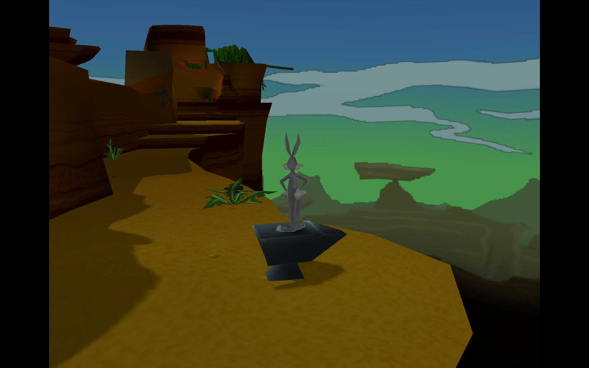
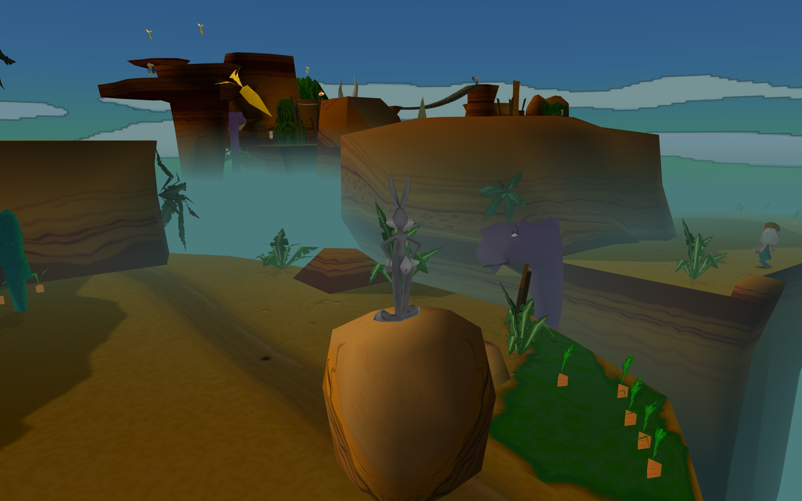
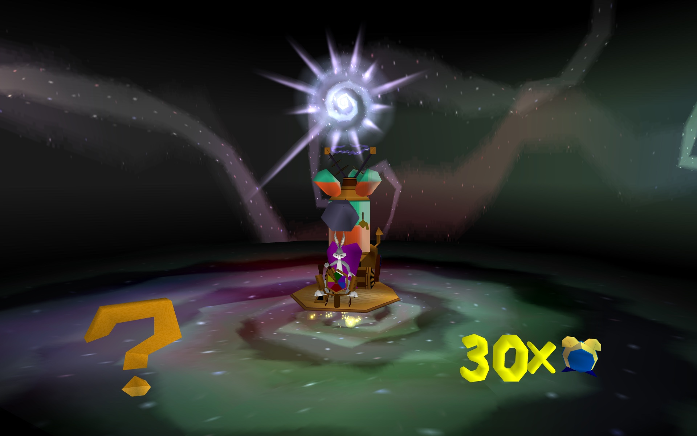

# BBLIT Remaster

[English](README.md) · **Русский**

**Bugs Bunny: Lost in Time (PC, 1999) на современном рендере.** Игра остаётся собой: та же логика, уровни, физика и сохранения. Картинку рисует новый рендер. Он плавный на любой частоте экрана, работает в широком формате, рисует дальше и даёт современное управление с геймпада.

Мод — это одна библиотека `ddraw.dll` и файл настроек `remaster.ini`. Файлы игры не меняются: удалите `ddraw.dll`, и игра снова будет как была.

> **Версия 1.0-beta.** Проверено на Linux (Steam + Proton, Legion Go 2 / Bazzite): основная проверка — уровни первой эпохи, остальные уровни — выборочно. На Windows мод собран и должен работать, но на настоящем железе ещё не проверялся. Если что-то не так, откройте issue и приложите `BIN\remaster.log`.

## До и после

«Wabbit on the run!», одно место и одна камера. Сверху — оригинал (4:3, родная дальность), снизу — BBLIT Remaster (широкий экран, дальность ×2, дымка у земли, яркость как на PS1).




Воронка времени между эпохами, BBLIT Remaster:



## Что вы получаете

**Плавность на любой частоте экрана.** Оригинал жёстко привязан к 30 кадрам в секунду: позиция, камера и анимация продвигаются раз за кадр, и просто поднять лимит нельзя, игра ускорится. Мод оставляет логику на родных 30 тиках, а между тиками рисует промежуточные кадры. Движение персонажей, камеры и анимации интерполируется, так что 60, 90, 120 и 144 Гц идут с нормальной скоростью игры. По умолчанию частота кадров равна частоте экрана.

Это не интерполяция кадров: ничего не угадывается по готовым картинкам, как в «плавности» телевизоров или генерации кадров, поэтому нет ни шлейфов, ни искажений. Каждый кадр рисуется из собственной геометрии игры. Мод берёт положения персонажей, предметов и камеры из двух соседних тиков игры и рисует сцену между ними. Интерполируется только движение: перемещение, камера и анимация. Сама логика игры (физика, столкновения, враги, управление) по-прежнему идёт на родных 30 тиках в секунду, как в оригинале. Так как каждый кадр лежит между двумя последними тиками, картинка отстаёт от логики игры на один тик (около 33 мс).

**Широкий экран без растяжения (Hor+).** На 16:9 и 16:10 видно больше по бокам, пропорции остаются правильными. Счётчики HUD прижаты к краям экрана (на экранах шире 16:9 — к краям рамки 16:9, чтобы не крутить головой; меняется ключом `hud_aspect`), меню остаётся по центру.

**Дальность прорисовки ×2.** Мир виден вдвое дальше, а персонажи и предметы — вчетверо дальше оригинала. Объекты вдали появляются плавно, а не выскакивают.

**Туман, потому что мир стал больше.** С увеличенной дальностью дальний край мира стал бы резким обрывом геометрии. Поэтому дальний мир плавно растворяется в цвете неба своего уровня, и граница не бросается в глаза. В «Wabbit on the run!» и «Magic Hare Blower» добавлена ещё дымка у земли: она прячет обрыв дальних скал (иначе, например, шея динозавра висит в воздухе). В остальных уровнях дымки нет, там она только темнила горизонт.

**Яркость как на PS1.** ПК-порт делит цвет вершин на 255, а на PS1 нейтраль — 0x80, поэтому мир на ПК был примерно вдвое темнее, чем на PS1. Мод возвращает яркость PS1, чуть приглушённую (×1,8 вместо ×2), чтобы не было пересвета. Регулируется ключом `ps1_light`.

**Чистая картинка.**
- Сглаживание MSAA 4×.
- Полупрозрачность PS1 (вода, стёкла, эффекты) рисуется правильными режимами смешивания, а не подделкой альфой, и не мерцает.
- Закрыты щели с видом на небо на изгибах скал.
- При быстром повороте камеры у краёв экрана нет дыр и рваных граней.
- Тексели, которые на PS1 непрозрачны, остаются непрозрачными и в полупрозрачных полигонах: силуэты корабля и островов с пальмами у горизонта тёмные, как на PS1.

**Современное управление с геймпада (XInput).**
- Аналоговая ходьба: лёгкий наклон стика — шаг, сильный — бег.
- Камера на правом стике. LT/RT поворачивают камеру в сторону нажатого триггера.
- Буфер прыжка: нажатие чуть раньше приземления не теряется.
- Start открывает и закрывает паузу, Back — пауза и «назад», B в паузе — «назад».

**Исправления.**
- Багз больше не утопает наполовину в толкаемом камне. Это ошибка ещё PS1-версии: форма столкновения камня смещена относительно его модели.
- Морковка машины времени больше не протыкает логотип на титульном экране.
- Норы в хабе (LS01) больше не мерцают и не пропадают: это неглубокие ямки под сплошной землёй, теперь они рисуются поверх земли, как на PS1.
- Пальмовый лист прямо перед камерой больше не вырезает дыры в Багзе, машине времени и норах за ним.
- Нет тонких линий по краям листьев и квадратного контура внутри нор (в оригинальном ПК-порте они тоже есть).
- Вихри над входами в уровни в хабе крутятся ровно, а не дёргаются и не «перезапускаются», когда к ним подходишь.
- Диск не нужен: проверку диска европейского и североамериканского изданий мод выключает в памяти (в русском её не было и так). Файлы игры не меняются.
- Слоты сохранений в главном меню остаются внутри своей панели, а не уезжают строкой к краю экрана.
- Стартовые логотипы заполняют фоном весь экран, а не стоят между чёрными полосами.
- «Hey What's Up, Dock?»: нырок в нору у плавучих бочек больше не отбрасывает Багза назад. Увеличенная дальность персонажей включала вторую нору, и она хватала Багза в сторону не того конца; теперь она, как в оригинале, нырок не замечает.
- «Hey What's Up, Dock?»: плавучий настил больше не рисуется плоской наклейкой на земле, острова неба и солнце не спорят с корпусом корабля по глубине (нет «приклеенной» к кораблю пальмы), тень Багза ложится на плавучую бочку, штурвал и откидной мост не появляются и не пропадают на стоковом радиусе.

**Портативные ПК (Linux/Proton).** На процессорах с быстрыми и энергоэффективными ядрами (Z2 Extreme в Legion Go 2 и подобные) главный поток игры закрепляется за быстрыми ядрами. На Windows с этим справляется её планировщик. На Legion Go 2 при TDP 10 Вт это дало 119–120 кадров даже в самых тяжёлых местах вместо 111–116.

## Что нужно

- **PC-версия Bugs Bunny: Lost in Time** с одним из этих `bugs.exe`. Мод сам узнаёт издание при запуске; с любым другим `bugs.exe` он не включается, и игра идёт как обычно.

  | Издание | Выпуск | SHA-256 `bugs.exe` | Проверено |
  |---|---|---|---|
  | Европа 1.0, мультиязычное | Диск Infogrames (английский, французский, немецкий, итальянский, испанский). Обычно встречается как `Bugs Bunny - Lost in Time [En,Fr,De,It,Es] (PC).iso` | `74ab71e175a3f186460582cf5b870c2d216ff10d7fedd683b960aa59269f1be4` | Linux / Proton |
  | Северная Америка 1.6 | Диск Infogrames (английский, французский, испанский). Обычно встречается как `Bugs Bunny Lost in Time.iso` | `6e15f92076614e3ee218c34c5dee566bf273e5bfee77d831cfbf78aa2d29e235` | Linux / Proton |
  | Русское 1.6 | CITY, перевод «Дядюшка Рисёч» | `7342f72443aad4f6efb366449f123dbe2baf7d45cbd1f3e8512aa70506512139` | Linux / Proton |
  | Испанское 1.0 | «Bugs Bunny: Perdido en el Tiempo» | `3eae4e369d79a02d0b3cafeb7c5f80f6bbba7cf4ffc02a56876aaa885d5bc050` | Windows, участник проекта |

  Все по 772 096 байт. **Не знаете, какую копию взять? Берите европейский или североамериканский диск**: они встречаются чаще всех, и с модом им не нужны ни сам диск, ни no-CD патч. Как проверить свою копию: на Windows в папке `BIN` выполните `certutil -hashfile bugs.exe SHA256`, на Linux — `sha256sum bugs.exe`. Пропатченные копии (no-CD, другие моды) отличаются кодом и не поддерживаются, нужен оригинальный `bugs.exe`. С неподдерживаемым файлом в `BIN\remaster.log` будет строка «неподдерживаемый bugs.exe», см. [Другие издания](#другие-издания).
- Видеокарта с **OpenGL 4.6** (проверено): на Linux — Mesa (AMD, Intel), на Windows — актуальный драйвер AMD, NVIDIA или Intel. Должны подойти и старые драйверы, вплоть до OpenGL 3.3.
- Геймпад XInput (Xbox-совместимый, Steam Deck, Legion Go, DualSense через Steam Input). Клавиатура работает как в оригинале.

## Установка

### Установка игры с европейского или североамериканского диска

- **Windows:** запустите `Setup.exe` с диска и установите как обычно.
- **Linux, Steam Deck:** установщик не нужен. Скопируйте папки `bin`, `bze`, `data`, `speeches` и `track` из папки `Datas` на диске в новую папку (например, `~/Games/Bugs Bunny`), переименуйте `bin` в `BIN` и сделайте файлы доступными для записи (`chmod -R u+w ~/Games/Bugs\ Bunny`): сохранения и настройки пишутся в `BIN`. Игра запустится на английском.

Некоторые копии образа диска — «сырые» образы CD (секторы по 2352 байта), хотя называются `.iso`; архиваторы и `mount` их не открывают. Такой образ сначала преобразуйте, например `iat image.iso fixed.iso` (пакет `iat`).

Скачайте `BBLIT-Remaster-1.0-beta.zip` со страницы [Releases](../../releases) и распакуйте в папку игры. Файлы `ddraw.dll` и `remaster.ini` должны оказаться в папке `BIN`, рядом с `bugs.exe`.

Запускать нужно **`BIN\bugs.exe` напрямую** с параметрами `/opengl /win /b0 /x800 /y600`, а не через лаунчер `BugsBunny.exe`:
- `/opengl` — OpenGL-режим движка, мод работает только в нём;
- `/win` — окно, мод сам растягивает его на весь экран без рамки;
- `/b0` — сразу главное меню, без вступительного ролика;
- `/x800 /y600` — внутренний вьюпорт движка; мод всё равно рисует в разрешении экрана.

### Linux (Steam + Proton, Steam Deck, Bazzite)

1. В Steam: «Добавить игру» → «Добавить стороннюю игру», выберите `BIN/bugs.exe` установленной игры.
2. В свойствах ярлыка: «Совместимость» → Proton Experimental (проверялось на нём).
3. Параметры запуска:
   ```
   WINEDLLOVERRIDES="ddraw=n,b" PROTON_NO_NTSYNC=1 PROTON_NO_FSYNC=1 PROTON_NO_ESYNC=1 %command% /opengl /win /b0 /x800 /y600
   ```
   - `WINEDLLOVERRIDES="ddraw=n,b"` — Wine берёт `ddraw.dll` мода, а не встроенную.
   - `PROTON_NO_NTSYNC/FSYNC/ESYNC=1` **обязательны**: с новыми механизмами синхронизации Wine игра (и оригинал тоже) зависает.
4. Раскладка Steam Input — «Геймпад». Не назначайте кнопки на клавиши F1–F12.
5. В Game Mode частоту экрана можно ограничить в меню производительности. Игра сама подстроится под неё.

### Windows

> На Windows мод проверял участник проекта с испанским изданием. Если запустили, расскажите в issues, как прошло.

1. Скопируйте `ddraw.dll` и `remaster.ini` в папку `BIN` игры.
2. Создайте ярлык на `BIN\bugs.exe`. В свойствах ярлыка, в поле «Объект», допишите параметры после кавычек:
   ```
   "C:\...\Bugs Bunny\BIN\bugs.exe" /opengl /win /b0 /x800 /y600
   ```
3. Запускайте игру этим ярлыком. Если запускать через лаунчер, параметров `/opengl /win` не будет. В поле «Рабочая папка» ярлыка укажите папку `BIN` игры: движок открывает файлы по относительным путям.
4. Включите вертикальную синхронизацию для `bugs.exe` в панели драйвера (NVIDIA: «Вертикальный синхроимпульс» → «Вкл.»; AMD: Wait for Vertical Refresh → Always On). Мод подстраивает кадры под vsync.
5. При масштабе экрана больше 100 % мод переводит игру в режим DPI-aware, и она рисует в полном разрешении.

### Как убедиться, что мод работает

После запуска в `BIN` появится `remaster.log`, в первых строках `BBLIT Remaster 1.0-beta`. Картинка заполняет весь широкий экран, а камера на правом стике поворачивается.

### Как удалить

Удалите `ddraw.dll` (и, если хотите, `remaster.ini` и `remaster.log`) из папки `BIN`. На Linux уберите параметры запуска.

## Управление (геймпад)

| Кнопка | Действие |
|---|---|
| Левый стик | Ходьба: лёгкий наклон — шаг, сильный — бег |
| Правый стик | Поворот камеры |
| LT / RT | Поворот камеры (как L2/R2 на PS1) |
| A / B / X / Y | ✕ / ○ / □ / △ PS1-версии |
| LB / RB | L1 / R1 |
| Start | Пауза: открыть и закрыть; в главном меню — «Нажмите Enter» |
| Back | Пауза; в меню — «назад» |
| B в паузе | «Назад» |

## Настройки

Основные настройки лежат в `BIN\remaster.ini` с комментариями. Секция `[live]` применяется на лету, раз в секунду, так что её можно править прямо во время игры. Самое полезное:

| Ключ | Секция | По умолчанию | Что делает |
|---|---|---|---|
| `fps` | `[remaster]` | 0 | 0 — частота экрана, -1 — кратное 30 вниз, число — свой лимит |
| `msaa` | `[remaster]` | 4 | Сглаживание: 0, 2, 4, 8 |
| `cam_speed`, `cam_invert` | `[remaster]` | 52, 0 | Скорость и инверсия камеры на правом стике |
| `draw_dist` | `[live]` | 200 | Дальность мира, % от оригинала (100 — как было) |
| `actor_dist` | `[live]` | 400 | Дальность персонажей и предметов, % |
| `haze` | `[live]`, `[levelN]` | 0 / 100 | Дымка у земли, сила %; по уровням — в секциях `[levelN]` |
| `ps1_light` | `[live]` | 18 | Яркость мира ×10: 20 — точно как на PS1, 10 — как ПК-порт, 0 — путь ПК-порта |
| `xinput` | `[remaster]` | 1 | 0 — геймпад как в оригинале |
| `big_cores` | `[remaster]` | 1 | Главный поток на быстрых ядрах гибридных процессоров (Linux/Proton) |
| `dive_gate` | `[remaster]`, `[live]` | 1 | Норы (уровень с доками): 1 — нора, которую держит `actor_dist`, нырок игнорирует, как в оригинале; 0 — выкл.; 2 — только лог |
| `sky_dome` | `[remaster]`, `[live]` | 1 | Купол неба, пришитый к камере (уровень с доками: острова, солнце), рисуется как задник; 0 — как рисует движок |
| `shadow_act` | `[remaster]`, `[live]` | 25 | Тени, которые ложатся на персонажей и предметы (Багз на бочке): % от обычной подтяжки к камере, 0 — выкл. |
| `part_extra` | `[remaster]` | 1024 | Сколько частей добавить в пул для дальних персонажей (свой буфер); 0 — пул движка |
| `hud_aspect` | `[live]` | 178 | Самая широкая рамка для счётчиков HUD, соотношение сторон ×100: 178 — рамка 16:9 (на экранах 16:9 и 16:10 это края экрана, на сверхшироких — ближе к центру), 0 — всегда края экрана, 133 — позиции оригинала 4:3 |
| `splash_fill` | `[remaster]` | 1 | Стартовые логотипы: продолжить их однотонный фон на боковые полосы; 0 — чёрные полосы, как в оригинале |

## Известные ограничения beta

- Текстуры оригинальные, без замены и апскейла.
- При малом TDP в самых тяжёлых местах изредка (около раза в секунду) один кадр повторяется.
- На Windows мод проверял только участник проекта, с испанским изданием.
- Поддерживаются только издания из раздела [Что нужно](#что-нужно).

## Другие издания

Если вашего `bugs.exe` нет в таблице, откройте issue и приложите `BIN/remaster.log` и вывод этой проверки (Python 3, без дополнительных пакетов; файл она не меняет):

```sh
python3 -I tools/verify_exe.py "/путь/к/BIN/bugs.exe"
```

Она выводит SHA-256 файла, CRC32 секции `.text` и сколько мест перехвата совпадает с каждой известной раскладкой кода. Не обходите проверки: для другого издания нужно сопоставить и проверить каждый адрес кода, который использует мод ([docs/porting-editions.md](docs/porting-editions.md)).

## Сборка из исходников

Нужны кросс-компилятор MinGW-w64 для i686 и Python 3 (`build.sh` сначала проверяет, что каждый адрес кода в исходниках идёт через таблицу изданий):

```
# Ubuntu/Debian: sudo apt install gcc-mingw-w64-i686
# macOS:         brew install mingw-w64
./build.sh          # → build/ddraw.dll
```

Каждый push собирается в GitHub Actions. Тег `v*` выпускает релиз с готовым архивом.

Устройство мода:
- `ddraw.dll` — прокси: системный DirectDraw пробрасывается дальше, а DLL узнаёт издание `bugs.exe` по CRC32 его кода, переводит адреса перехватов в раскладку кода этого издания (`src/addr.h`) и ставит перехваты, перед каждым сверяя ожидаемые байты.
- Вызовы OpenGL движка записываются в снимки по одному на тик логики.
- Свой рендер (OpenGL 4.6, шейдеры) рисует кадры между снимками с интерполяцией.
- Ввод XInput подставляется в разбор пада самой игры.

Реверс сделан в Ghidra и [REA](https://github.com/morluto/rea).

## Лицензия

MIT — см. [LICENSE](LICENSE). Bugs Bunny и Looney Tunes — товарные знаки Warner Bros. Мод не содержит файлов игры, для него нужна своя копия игры.
